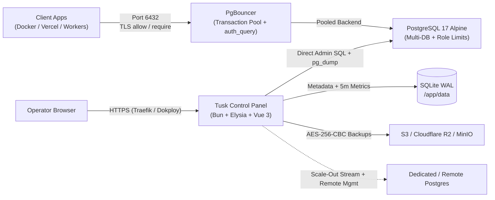

<div align="center">
  
</div>

# Tusk — Self-Hosted PostgreSQL Control Panel

[](https://github.com/rasyiqism/Tusk/actions/workflows/ci.yml)
[](https://github.com/rasyiqism/Tusk/actions/workflows/release-docker.yml)
[](https://rasyiqism.github.io/Tusk/)
[](LICENSE)

A lightweight, zero-bloat, single-operator PostgreSQL Control Panel (**Bun + ElysiaJS + Vue 3 SPA + SQLite WAL + PgBouncer**) designed to run multiple isolated project databases on one small VPS (**Dokploy** or **Docker Compose**), tune vertically as workloads grow, and graduate heavy databases outward to dedicated PostgreSQL servers — with **no third-party SaaS lock-in**.



---

## Why Tusk?

Running a full Postgres + BaaS stack per project wastes gigabytes of RAM on a single VPS, while cheap hosted DBaaS free tiers frequently hit connection pool exhaustion (`EMAXPOOLSREACHED`) and cold-start timeouts.

**Tusk** keeps the baseline control plane lean while preserving serious operational guardrails:

* **Shared Cluster, Real SQL Isolation:** One `postgres:17-alpine` container houses multiple isolated databases (`REVOKE ALL ON DATABASE ... FROM PUBLIC`), non-superuser roles (`NOSUPERUSER NOCREATEDB NOCREATEROLE`), per-role `CONNECTION LIMIT`, `statement_timeout`, `idle_in_transaction_session_timeout = 15s`, and `temp_file_limit = 500MB`.
* **Built-In `PgBouncer` Transaction Pooling:** Serves up to `2000` concurrent client connections (`max_prepared_statements = 200`, dynamic `pgbouncer.user_lookup` SCRAM auth query, automatic TLS certificate generation on `pgbouncer_tls`) supporting both internal Docker traffic (`sslmode=disable`) and external TLS (`sslmode=require`).
* **Zero Privileged Host Access:** `pg-panel` never mounts `/var/run/docker.sock` and communicates with PostgreSQL strictly via standard SQL/client tooling.
* **Safe Across Redeploys & Upgrades:** Forward-only SQLite migrations with automatic pre-migration `VACUUM INTO` backups, `SIGTERM` active-job draining, SQLite WAL truncation checkpoints, extended Docker `stop_grace_period`, and automatic crash reconciliation on boot.
* **Built to Scale Up & Out:** Start on a 2–4 GB VPS, tune Postgres memory/pools via `.env`, watch 24h/7d time-series saturation advisories, and stream any growing DB straight into a dedicated server when it outgrows the shared node.

---

## Feature Matrix

| Category | Capabilities |
| :--- | :--- |
| **Database Provisioning** | 1-click DB + role creation, `AES-256-GCM` encrypted password vault, password rotation, streaming clone (`pg_dump \| pg_restore`), pause/resume (`REVOKE CONNECT` + `NOLOGIN`), 14-day soft-delete Trash with undelete & instant purge (`?purge=1`). |
| **Per-DB Scale & Schedules** | Configurable per-role `CONNECTION LIMIT` (`1..500`), `statement_timeout` (`1..3600s`), custom 5-field `backup_cron`, and retention days (`1..3650`). |
| **Scale-Out & Remote Mode** | Target connectivity & recovery preflight check, live streaming `pg_dump \| pg_restore` to dedicated/managed Postgres over SSE, optional write-pause cutover, and **Promote to Remote** (`remote_admin_url_enc`) to keep managing the external node from Tusk. |
| **Encrypted Backups & DR** | Automated compression detection (`--compress=zstd:3` or `--compress=6`), streaming OpenSSL `aes-256-cbc` (`-pbkdf2`) encryption, S3/R2/MinIO upload with local disk cleanup, streaming decrypted downloads, 1-click restore with mandatory `pre_restore` safety snapshot, weekly archive TOC integrity verification (`pg_restore --list`), and `scripts/cold-dr.sh`. |
| **Observability & Diagnostics** | Live VPS RAM/Disk/Load 1m, 5-minute SQLite time-series sparklines (`24h`/`7d`), capacity saturation & cache-hit advisories, PgBouncer `SHOW POOLS` stats, live `pg_stat_activity` inspection with safe client PID termination, `pg_stat_statements` top slow queries, and read-only Table Inspector (`_prisma_migrations`, `__drizzle_migrations`, CamelCase support + 25-row preview). |
| **Security & Alerting** | Fail-closed Argon2id authentication (`PANEL_ADMIN_PASSWORD_HASH_B64`), optional RFC 6238 TOTP 2FA, IP rate limiting (`429`), server-side session revocation (`revoked_tokens`), `Origin`/`Sec-Fetch-Site` anti-CSRF guard, outbound anti-SSRF protection, full audit log, and alerts via `ntfy`, Webhook, or SMTP (`465`/`587`). |

---

## Tech Stack

| Layer | Technology |
| :--- | :--- |
| **API Runtime & Framework** | [Bun](https://bun.sh/) `1.x` + [ElysiaJS](https://elysiajs.com/) + `@elysiajs/cron` |
| **Frontend SPA** | [Vue 3](https://vuejs.org/) + TypeScript + Vite + Tailwind CSS v4 + Eden Treaty |
| **Panel Persistence** | `bun:sqlite` (WAL mode, `synchronous = FULL`, forward-only `schema_migrations`) |
| **Database & Pooler** | `postgres:17-alpine` + `edoburu/pgbouncer:v1.23.1-p0` (`postgresql17-client`, `openssl`) |

---

## Repository Structure

```text
Tusk/
├── docker-compose.yml            # 3-service production stack (postgres, pgbouncer, pg-panel)
├── .env.example                  # Documented environment template & vertical scale presets
├── docs/
│   ├── DEPLOYMENT.md             # Full VPS / Dokploy setup, env vars, scaling, DR & troubleshooting
│   ├── ARCHITECTURE.md           # Deep-dive internals, security model, crash/redeploy lifecycle
│   └── API.md                    # Complete HTTP + SSE endpoint & payload reference
├── pgbouncer/
│   └── Dockerfile                # Adds openssl & persistent /etc/pgbouncer/tls directory
├── scripts/
│   ├── init-auth-query.sh        # Initializes pg_stat_statements & pgbouncer.user_lookup on first boot
│   ├── init-secrets.sh           # Generates cryptographically random .env secrets for standalone VPS
│   └── cold-dr.sh                # Standalone emergency restore for .dump.enc archives
└── panel/
    ├── Dockerfile                # Multi-stage build (Vue SPA + Bun API runtime)
    └── apps/
        ├── api/                  # ElysiaJS backend, SQLite schema, services & Bun tests
        └── web/                  # Vue 3 + Tailwind SPA dashboard
```

---

## Quick Start (Standalone VPS / Local Docker Compose)

1. **Clone the repository and make scripts executable:**
   ```bash
   git clone https://github.com/rasyiqism/Tusk.git
   cd Tusk
   chmod +x scripts/init-secrets.sh scripts/cold-dr.sh scripts/init-auth-query.sh
   ```
2. **Generate `.env` with strong secrets and Argon2id password hash:**
   ```bash
   ./scripts/init-secrets.sh
   ```
   *(You will be prompted to confirm overwriting if `.env` already exists; review `PUBLIC_DB_HOST` and optional `S3_*` settings in `.env`.)*
3. **Build and launch the stack:**
   ```bash
   docker compose up -d --build
   ```
   *(Or use the prebuilt multi-arch GHCR image: `PANEL_IMAGE=ghcr.io/rasyiqism/tusk:latest docker compose up -d`)*
4. **Access the control panel:**
   Open `http://127.0.0.1:4310` on the host (bound safely to loopback by default; route externally via HTTPS reverse proxy such as Traefik, Caddy, or Dokploy).

---

## Deploying on Dokploy

1. In Dokploy, create a **Docker Compose** service pointing to `https://github.com/rasyiqism/Tusk.git` (`docker-compose.yml`).
2. In the **Environment** tab, paste your generated secrets (`PG_SUPERUSER_PASSWORD`, `PGBOUNCER_AUTH_PASSWORD`, `MASTER_KEY`, `BACKUP_ENCRYPTION_KEY`, `PANEL_ADMIN_PASSWORD_HASH_B64`, `PUBLIC_DB_HOST`). Always use `PANEL_ADMIN_PASSWORD_HASH_B64` in Dokploy so `$` characters in Argon2id hashes are never mangled.
3. In the **Domains** tab, route your panel domain (e.g. `tusk.yourdomain.com`) to service **`pg-panel`**, Container Port **`3000`**, with **HTTPS On** (Let's Encrypt).
4. Point a DNS `A` record (`db.yourdomain.com`, **DNS Only** if behind Cloudflare) to your VPS IP and allow inbound TCP port **`6432`** in your firewall for external PostgreSQL connections. **Do not** register `db.yourdomain.com` in Dokploy's HTTP Domains tab.

For full step-by-step instructions, scaling presets, S3/R2 setup, and troubleshooting, read **[docs/DEPLOYMENT.md](docs/DEPLOYMENT.md)**.

---

## Documentation Index

Online site (GitHub Pages): **[https://rasyiqism.github.io/Tusk/](https://rasyiqism.github.io/Tusk/)**

* **[Production Deployment, Scaling & Operations Guide](docs/DEPLOYMENT.md)** — Secrets generation, Dokploy setup, S3/R2 backups, alerts, redeploy safety, vertical/horizontal scaling, Cold DR, and troubleshooting.
* **[System Architecture & Internals](docs/ARCHITECTURE.md)** — Multi-tenant SQL isolation, PgBouncer auth flow, SQLite migration & crash recovery lifecycle, encryption design, and trade-offs.
* **[HTTP & SSE API Reference](docs/API.md)** — Every endpoint, auth/CSRF header rule, query parameter, JSON schema, and live stream contract.
* **[Security Policy](SECURITY.md)** — Hardening guarantees and vulnerability disclosure.
* **[Contributing Guide](CONTRIBUTING.md)** — Local dev workflow, Husky gates, and testing standards.
* **[Changelog](CHANGELOG.md)** & **[MIT License](LICENSE)**
