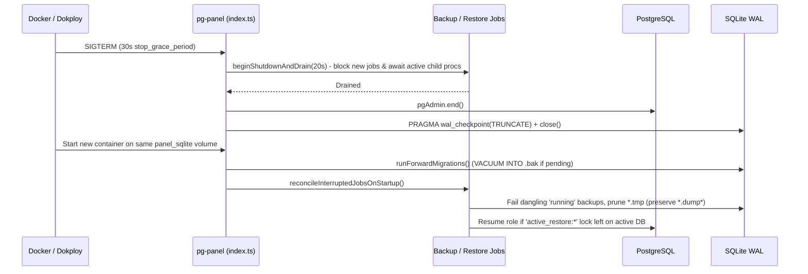

# Architecture & Internals

Technical reference describing how **Tusk** isolates multi-tenant databases, manages pooling and encryption, survives container redeploys, and streams backups and migrations with minimal memory overhead.

---

## 1. Runtime Topology

Tusk separates responsibilities cleanly across three containers sharing an internal Docker bridge (`pg_internal`):

1. **`postgres` (`postgres:17-alpine`)**
   * Holds all managed project databases inside volume `pg_shared_data` (`/var/lib/postgresql/data`).
   * Configured with `shared_preload_libraries=pg_stat_statements`, `password_encryption=scram-sha-256`, `log_statement=ddl`, `log_min_duration_statement=500`, and env-tunable memory/connection parameters (`PG_SHARED_BUFFERS`, `PG_EFFECTIVE_CACHE_SIZE`, `PG_WORK_MEM`, `PG_MAINTENANCE_WORK_MEM`, `PG_MAX_CONNECTIONS`).
   * Port `5432` is internal to `pg_internal` only — not published to the public host interface.
2. **`pgbouncer` (`edoburu/pgbouncer:v1.23.1-p0` + `openssl`)**
   * Runs in `POOL_MODE=transaction` with `AUTH_TYPE=scram-sha-256` and `MAX_PREPARED_STATEMENTS=200`.
   * Instead of storing static app user hashes on disk in `userlist.txt`, it stores only `pgbouncer_auth` and `postgres` in `/etc/pgbouncer/userlist.txt`, resolving every app role dynamically via `AUTH_QUERY = SELECT usename, passwd FROM pgbouncer.user_lookup($1)` (`SECURITY DEFINER` over `pg_authid`, granted strictly to `pgbouncer_auth`).
   * Generates a persistent x509 certificate in `pgbouncer_tls` on first boot and sets `CLIENT_TLS_SSLMODE=allow` (or env override).
3. **`pg-panel` (`oven/bun:1-alpine` + `postgresql17-client` + `openssl`)**
   * Serves the compiled Vue 3 SPA (`apps/api/public`) and ElysiaJS API on container port `3000` (host `127.0.0.1:4310`).
   * Runs unprivileged **without** `/var/run/docker.sock`.
   * Stores control-plane metadata, encrypted secrets, backup records, audit trail, revoked tokens, and 5-minute metric samples in SQLite WAL (`/app/data/pg-panel.sqlite` on `panel_sqlite`).

---

## 2. Database Isolation Model

Every provisioned database in `services/postgres.ts` receives a dedicated least-privilege PostgreSQL role and database:

```sql
CREATE ROLE "<db_username>"
  WITH LOGIN PASSWORD '...'
  CONNECTION LIMIT <connection_limit>
  NOSUPERUSER NOCREATEDB NOCREATEROLE;

ALTER ROLE "<db_username>" SET statement_timeout = '<statement_timeout_sec>s';
ALTER ROLE "<db_username>" SET idle_in_transaction_session_timeout = '15s';
ALTER ROLE "<db_username>" SET temp_file_limit = '500MB';

CREATE DATABASE "<db_name>" OWNER "<db_username>";
REVOKE ALL ON DATABASE "<db_name>" FROM PUBLIC;
GRANT ALL ON DATABASE "<db_name>" TO "<db_username>";
```

* **Identifier & Object Safety:**
  * Newly created database/role names must match `assertPgIdentifier` (`^[a-z][a-z0-9_]{1,62}$`).
  * Table Inspector schema/table lookups use `assertPgObjectName` (`^[A-Za-z_][A-Za-z0-9_-]{0,62}$`), supporting ORM metadata tables (`_prisma_migrations`, `__drizzle_migrations`) and CamelCase identifiers safely without injection.
* **Pause / Soft-Delete Without Breaking Backups:**
  * Pausing or soft-deleting an instance executes `REVOKE CONNECT ON DATABASE ... FROM PUBLIC`, `ALTER ROLE ... NOLOGIN`, and terminates existing client sessions for that database.
  * It does **not** set `ALLOW_CONNECTIONS = false`, allowing superuser `postgres` (`pg-panel`) to continue performing `pg_dump`, table inspection, and `pg_restore`.
  * Deleting moves the instance to Trash after taking a mandatory `pre_delete` backup (unless `?force=1`); automatic hard purge runs via daily `04:00` cron after 14 days (or immediately via `DELETE /api/instances/:id?purge=1`).

---

## 3. Cryptography, Auth & Network Guardrails

### Key Derivation (`panel/apps/api/src/lib/crypto.ts`)
From `MASTER_KEY` (startup fails fast in `NODE_ENV=production` if `< 16` characters), Tusk derives two independent 256-bit keys via `scryptSync`:
* `AES_KEY` (`salt: "pg-panel-aes-v1"`) $\rightarrow$ `AES-256-GCM` encryption (`iv.tag.ciphertext` hex) for database role passwords (`encrypted_password`) and promoted remote Postgres admin URLs (`remote_admin_url_enc`).
* `SESSION_SECRET` (`salt: "pg-panel-session-v1"`) $\rightarrow$ `HMAC-SHA256` signed session tokens (`exp.nonce.sig`), verified with `timingSafeEqual`.

### Authentication & CSRF (`panel/apps/api/src/routes/auth.ts`, `index.ts`)
* **Fail-Closed Auth:** Unauthenticated requests return `401` unless both `NODE_ENV !== "production"` and `REQUIRE_AUTH !== "true"` and no admin hash is set.
* **Login Brute-Force Limiter:** Tracks failed attempts per resolved client IP (`resolveClientIp` trusts `X-Forwarded-For` / `X-Real-IP` only when the underlying socket IP is private/loopback — preventing IP header spoofing), returning `429` after 5 failures within a 15-minute window.
* **Server-Side Revocation:** `POST /api/auth/logout` stores `SHA-256(token)` with its expiry timestamp in SQLite `revoked_tokens`, invalidating stolen/logged-out cookies immediately.
* **CSRF Validation:** All mutating `/api/*` requests (`POST`, `PUT`, `PATCH`, `DELETE`) verify `Sec-Fetch-Site` and `Origin` against `Host` / `X-Forwarded-Host` (or explicit `CORS_ORIGIN`).

### Anti-SSRF (`panel/apps/api/src/lib/safeOutboundUrl.ts`)
Outbound URLs for `ntfy`, webhooks, SMTP hosts, and scale-out migration targets resolve DNS via `dns/promises.lookup` and reject non-HTTP(S) schemes (for webhooks) as well as loopback, link-local (`169.254.169.254` cloud metadata), and RFC1918 private IPs unless `ALLOW_INTERNAL_URLS=true`.

---

## 4. SQLite Persistence, Migrations & Crash Recovery

`panel/apps/api/src/db/schema.ts` configures `pg-panel.sqlite` with:
```sql
PRAGMA journal_mode = WAL;
PRAGMA synchronous = FULL;
PRAGMA busy_timeout = 5000;
```

### Forward-Only Migrations (`runForwardMigrations`)
1. Tracks applied schema versions in `schema_migrations (version, name, applied_at)`.
2. Before running pending migrations on any existing non-empty database (`v1` baseline or `v2` scale-up columns & `metrics_samples`), executes `VACUUM INTO '<dbPath>.pre-v<target>.bak'` to guarantee a clean, transactionally consistent snapshot even in WAL mode.
3. Wraps pending DDL updates inside an atomic SQLite transaction using idempotent `addColumnIfMissing` guards.

### Redeploy Lifecycle (`SIGTERM` Drain & Startup Reconcile)


---

## 5. Streaming Backup, Verification & Scale-Out Pipelines

* **Backups (`services/backup.ts`):**
  * Automatically detects whether `pg_dump` supports `--compress=zstd:3` (falling back to `--compress=6`).
  * Pipes `pg_dump` stdout directly into `openssl enc -aes-256-cbc -salt -pbkdf2` when `BACKUP_ENCRYPTION_KEY` is set, uploads to S3 if configured, and removes the local temp archive.
  * Per-instance `backup_cron` evaluation checks every minute (`cronMatchesNow`) with minute-level deduplication so `prod`, `staging`, and `dev` DBs can run on distinct schedules.
* **Downloads (`getBackupDownloadResponse`):** Decrypts via `openssl` stream directly into the HTTP response `ReadableStream` without loading archives into memory and cleans temp files on completion or client abort (`cancel()`).
* **Restore (`restoreBackupById`):** Always captures and verifies a `pre_restore` backup first, acquires an `active_restore:<instanceId>` lock in SQLite, pauses client logins on the DB, restores with `--clean --if-exists --no-owner --role=<db_username>`, and resumes logins cleanly in `finally`.
* **Scale-Out & Bidirectional Layer 2 (`services/migration.ts`, `services/layer2.ts`):** Validates connectivity + target non-replica state (`checkPgTargetHealth`), streams `pg_dump --format=custom --no-owner --no-acl | pg_restore --clean --if-exists --no-owner --no-acl` directly across hosts without intermediate files, and supports symmetric `primary_tier` switching (`'local' ↔ 'external'`) with post-backup `after_backup` mirroring and role-safe failback (`--role=<local_user>`).

---

## 6. Known Boundaries & Trade-Offs

By design, **Tusk** makes explicit engineering trade-offs to stay lightweight:
* **Single-Node Cluster:** All non-migrated DBs share one `postgres` container (`pg_shared_data`) — CPU, RAM (`shared_buffers`), disk space, and checkpoint I/O are shared. Use per-role `CONNECTION LIMIT` / `statement_timeout` and **Scale-Out** for heavy workloads.
* **Logical Snapshots (`pg_dump`):** Ideal for small-to-medium DBs (< 10–20 GB per DB), per-database isolated restores, and painless Postgres major upgrades. Does not provide continuous WAL Point-in-Time Recovery (PITR) to the exact second or automated multi-node failover.
* **Single Operator Model:** Designed for a solo developer or small trusted ops team sharing one admin credential (+ optional TOTP) rather than multi-tenant SaaS user workspaces with RBAC.
