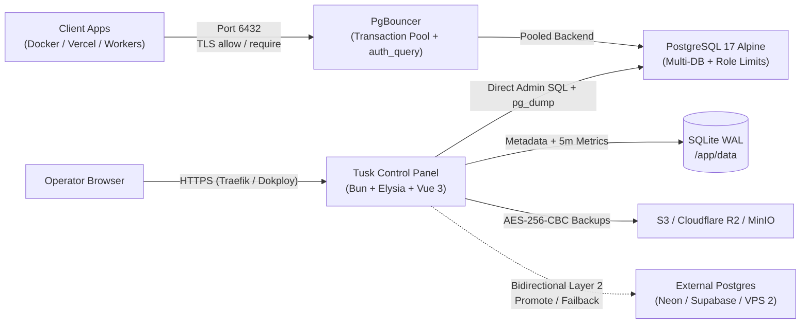

## Architecture Overview



## Quick Start

```bash
git clone https://github.com/rasyiqism/Tusk.git
cd Tusk
chmod +x scripts/init-secrets.sh scripts/cold-dr.sh scripts/init-auth-query.sh
./scripts/init-secrets.sh
docker compose up -d --build
```

Open **`http://127.0.0.1:4310`** on the host or follow [Production Deployment & Scaling](/DEPLOYMENT) for **Dokploy**, **Cloudflare R2**, **Vertical Tuning**, and **Layer 2 Failover**.
